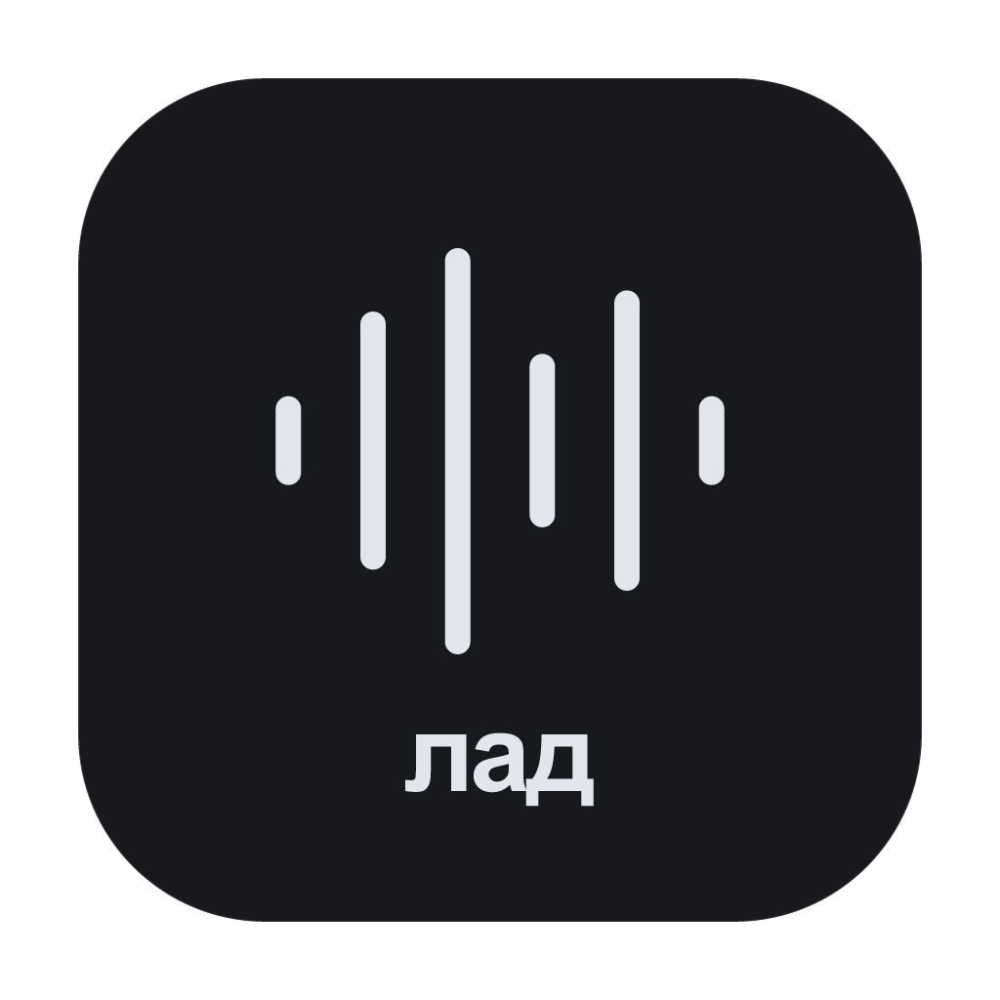
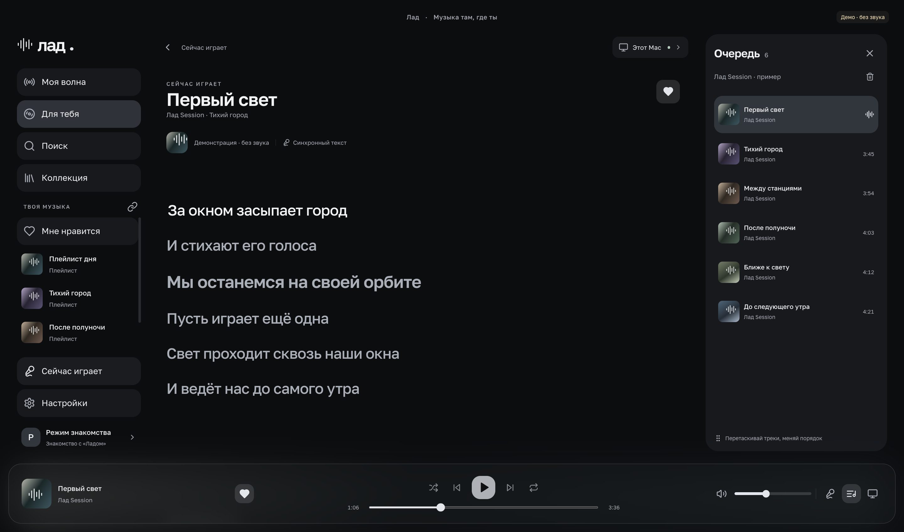
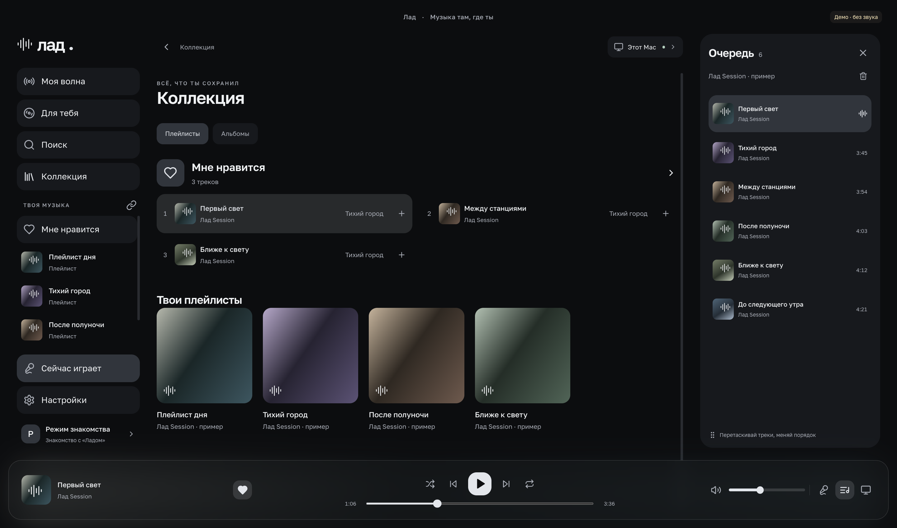
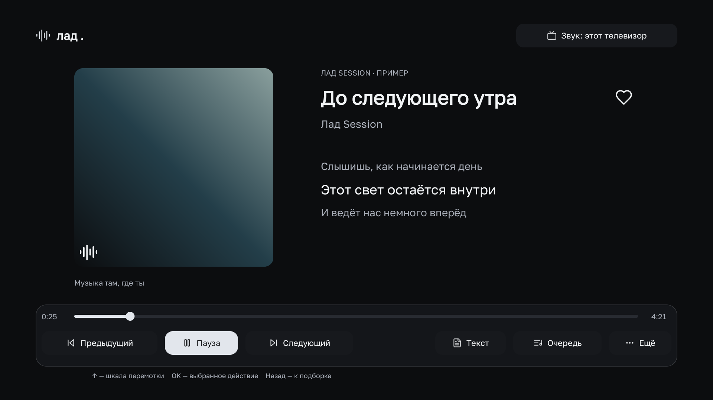

  
  <h1>Лад</h1>
  
<strong>Музыка здесь. Звук — где хочешь.</strong>

  
Неофициальный клиент Яндекс Музыки для macOS, Windows, Android и Android TV. Слушай на устройстве или управляй своей Яндекс Станцией по Wi-Fi.

  

    
    
    
  

  
<a href="#скачать">Скачать</a> · <a href="#возможности">Возможности</a> · <a href="docs/installation.md">Установка</a> · <a href="docs/development.md">Сборка</a> · <a href="CHANGELOG.md">История изменений</a>

## Возможности

- **Музыка и коллекция.** Поиск треков, альбомов и исполнителей, свои и понравившиеся плейлисты, любимые треки и альбомы, Моя волна.
- **Устройство или Станция.** Локальное воспроизведение и передача на Яндекс Станцию с сохранением позиции. Для управления колонкой устройства должны находиться в одной локальной сети. Bluetooth не требуется.
- **Очередь под контролем.** Играть следующим, добавить в конец, изменить порядок. Эти действия доступны и для целого альбома или плейлиста.
- **Текст рядом.** Синхронные строки, если Яндекс предоставляет тайминги, обычный текст в остальных случаях и настройка смещения синхронизации.
- **Обновления внутри приложения.** Проверка новых версий на GitHub, загрузка и установка по нажатию с проверкой подписи и файла.
- **Своё оформление.** Тёмная и OLED-темы, акценты, размер интерфейса, полупрозрачные поверхности и стекло.
- **Локальный фильтр E.** Пропуск треков с маркировкой 18+ независимо от настроек аккаунта Яндекса.
- **Системное управление.** Медиакнопки, управление в фоне и необязательная синхронизация громкости с устройством. После завершения воспроизведения на Станции прежняя локальная громкость восстанавливается.

### На каждом экране — своё управление

| Компьютер | Телефон | Телевизор |
| --- | --- | --- |
| Боковая навигация, закреплённые подборки, очередь и контекстные меню | Компактная навигация, свайпы обложек, соседние треки и меню удержанием | Управление пультом, явный фокус, экранная ЙЦУКЕН/QWERTY-клавиатура и режим картины |

<strong>Коллекция на компьютере</strong>

<strong>Плеер на телевизоре</strong>

На снимках используются демонстрационные данные.

## Скачать

Готовые приложения находятся в [Releases](https://github.com/KiriDey0/Lad/releases/latest).

| Платформа | Требования | Скачать |
| --- | --- | --- |
| macOS | macOS 13+, Apple Silicon | [Приложение в ZIP](https://github.com/KiriDey0/Lad/releases/latest/download/Lad-macOS-arm64-0.3.0.zip) |
| Windows | Windows 10/11, x64 | [Установщик](https://github.com/KiriDey0/Lad/releases/latest/download/Lad-Windows-Setup-0.3.0-x64.exe) · [Portable ZIP](https://github.com/KiriDey0/Lad/releases/latest/download/Lad-Windows-Portable-0.3.0-x64.zip) |
| Android | Android 8.0+ | [APK](https://github.com/KiriDey0/Lad/releases/latest/download/Lad-Android-0.3.0.apk) |
| Android TV / YaOS | Android 9+, ARMv7 | [TV APK](https://github.com/KiriDey0/Lad/releases/latest/download/Lad-TV-0.3.0-armv7.apk) |

[Все платформы одним архивом](https://github.com/KiriDey0/Lad/releases/latest/download/Lad-v0.3.0-all-platforms.zip) · [Исходный код](https://github.com/KiriDey0/Lad/releases/latest/download/Lad-Source-v0.3.0.zip) · [SHA256SUMS](https://github.com/KiriDey0/Lad/releases/latest/download/SHA256SUMS)

Инструкции по установке, входу и подключению колонки — в [руководстве](docs/installation.md). Для доступа к каталогу и воспроизведению нужна учётная запись Яндекса с соответствующим доступом к Яндекс Музыке; приложение не заменяет подписку Яндекс Плюс.

## Документация

- [Установка и первый запуск](docs/installation.md)
- [Плеер, очередь, тексты и управление](docs/usage.md)
- [Обновления приложения](docs/updates.md)
- [Как устроен проект](docs/architecture.md)
- [Разработка, сборка и тестирование](docs/development.md)
- [Подготовка релиза](docs/releasing.md)
- [Данные и конфиденциальность](docs/privacy.md)
- [Как внести изменения](CONTRIBUTING.md)

Ошибки и предложения можно оформить через [Issues](https://github.com/KiriDey0/Lad/issues). Об уязвимостях сообщай по инструкции в [SECURITY.md](SECURITY.md).

## Лицензия

Код Лада распространяется под **GNU Affero General Public License, только версия 3** — `AGPL-3.0-only`. Разрешения использовать последующие версии лицензии нет. Полный текст — [LICENSE](LICENSE), пояснение области действия — [NOTICE](NOTICE).

Шрифты, иконки и другие сторонние компоненты сохраняют свои лицензии: [THIRD_PARTY_NOTICES.md](THIRD_PARTY_NOTICES.md).

Лад — независимый проект, не официальный продукт Яндекса. Названия и материалы сервиса принадлежат их правообладателям.
