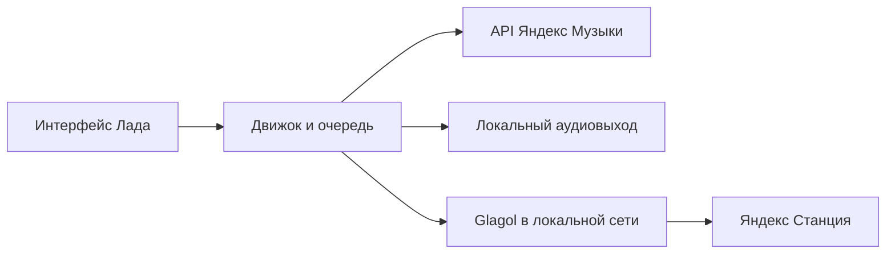

# Архитектура

Репозиторий содержит четыре самостоятельных приложения.

| Каталог | Реализация |
| --- | --- |
| `apps/macos` | Electron / React / TypeScript и Python-сервис |
| `apps/windows` | Electron / React / TypeScript, Python-сервис, Windows lifecycle и tray |
| `apps/android` | Kotlin / Compose, Media3, Android MediaSession |
| `apps/tv` | Kotlin / native Views, управление фокусом и DPAD, Media3 |

Desktop renderer изолирован от Node.js. Preload предоставляет ограниченный IPC-интерфейс; Python-сервис обменивается с главным процессом JSON через stdin/stdout. В packaged-приложение включён самостоятельный sidecar, внешний Python пользователю не требуется.

Нативные клиенты используют собственный движок, очередь и media service. TV имеет отдельную модель фокуса и поиска; телефон — жесты и Compose-переходы. Настройки E и громкости принадлежат Ладу, а доступ к каталогу и маркировка треков — сервису Яндекса.

Станция обнаруживается локально и сопоставляется со списком устройств аккаунта. Сертификат локального соединения сверяется с сертификатом, полученным для устройства владельца. Облачный пароль и произвольные адреса не отправляются на найденные в сети устройства.

`WaveSession`, проверки доступности треков и поколения операций отделяют очередь приложения от внешнего воспроизведения Станции. Устаревший ответ загрузки не должен возобновлять музыку после паузы, выхода или изменения фильтра.

Код движков пока расположен в платформенных каталогах. При изменении общей логики обновляй обе desktop- и обе нативные реализации и соответствующие тесты. UI каждой платформы развивается отдельно.
