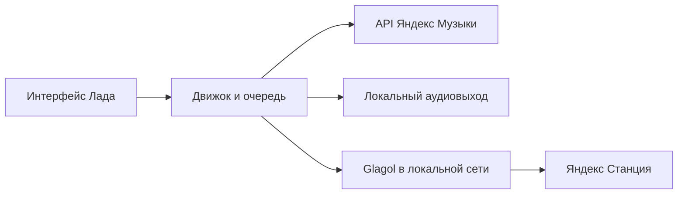

# Архитектура

Репозиторий содержит четыре самостоятельных приложения.

| Каталог | Реализация |
| --- | --- |
| `apps/macos` | Electron / React / TypeScript и Python-сервис |
| `apps/windows` | Electron / React / TypeScript, Python-сервис, Windows lifecycle и tray |
| `apps/android` | Kotlin / Compose, Media3, Android MediaSession |
| `apps/tv` | Kotlin / native Views, управление фокусом и DPAD, Media3 |

Desktop renderer изолирован от Node.js. Preload предоставляет ограниченный IPC-интерфейс; Python-сервис обменивается с главным процессом JSON через stdin/stdout. В packaged-приложение включён самостоятельный sidecar, внешний Python пользователю не требуется.

Нативные клиенты используют собственный движок, очередь и media service. TV имеет отдельную модель фокуса и поиска; телефон — жесты и Compose-переходы. Настройки E и громкости принадлежат Ладу, а доступ к каталогу и маркировка треков — сервису Яндекса.

Станция обнаруживается локально и сопоставляется со списком устройств аккаунта. Сертификат локального соединения сверяется с сертификатом, полученным для устройства владельца. Облачный пароль и произвольные адреса не отправляются на найденные в сети устройства.

`WaveSession`, проверки доступности треков и поколения операций отделяют очередь приложения от внешнего воспроизведения Станции. Устаревший ответ загрузки не должен возобновлять музыку после паузы, выхода или изменения фильтра.

Код движков пока расположен в платформенных каталогах. При изменении общей логики обновляй обе desktop- и обе нативные реализации и соответствующие тесты. UI каждой платформы развивается отдельно.

## Имена и комнаты Станций

Glagol предоставляет транспортную идентичность и сертификат колонки. Для пользовательского названия, комнаты и дома клиент делает отдельный read-only `GET https://api.iot.yandex.net/v1.0/user/info` с текущим OAuth-токеном. Токен не передаётся через перенаправления. Ошибка этого дополнительного запроса не скрывает транспортный список, но сбрасывает сведения о комнате в недоступное состояние.

Объект IoT связывается с Glagol исключительно через `quasar_info.device_id`. Названия, порядок записей и IP для сопоставления не используются. Комната разрешается по ID внутри того же дома; отсутствующие и конфликтующие сведения не угадываются. Если имя равно названию модели, главным заголовком становится комната, а модель остаётся рядом. Совпадающие имя, комната и дом считаются неоднозначным выбором: обычный перенос блокируется движком. Интерфейс позволяет отдельно подтвердить «Всё равно включить» для конкретного ID и актуальных метаданных. Это разовое согласие сбрасывается при смене выбора или обновлении списка.

На TV фокус и выбор строки не переносят звук. Передача выполняется отдельным подтверждением, в котором видно выбранное место. Эти ограничения относятся к новому переносу; открытие списка и чтение метаданных не отправляют команд колонке.
